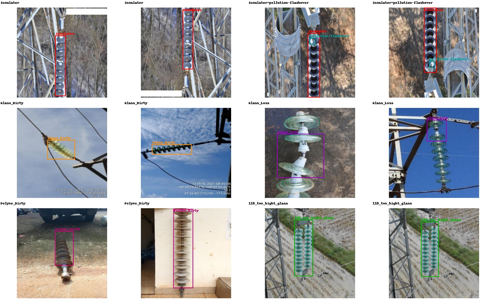
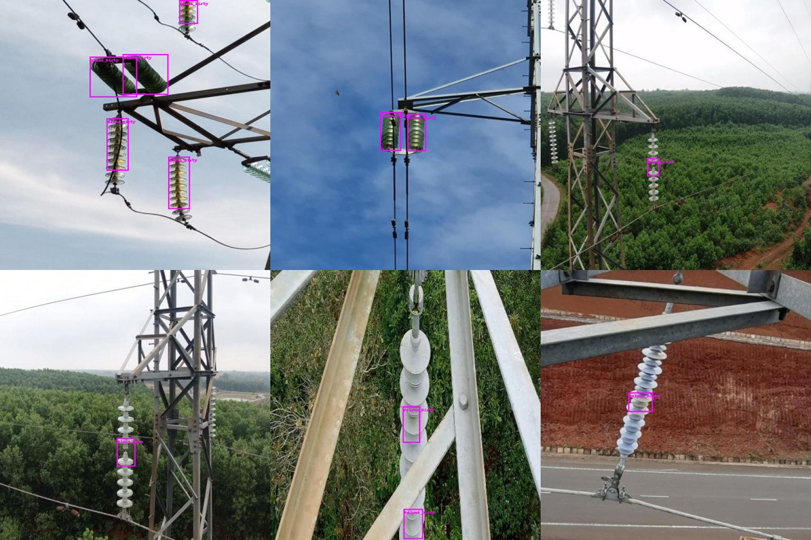
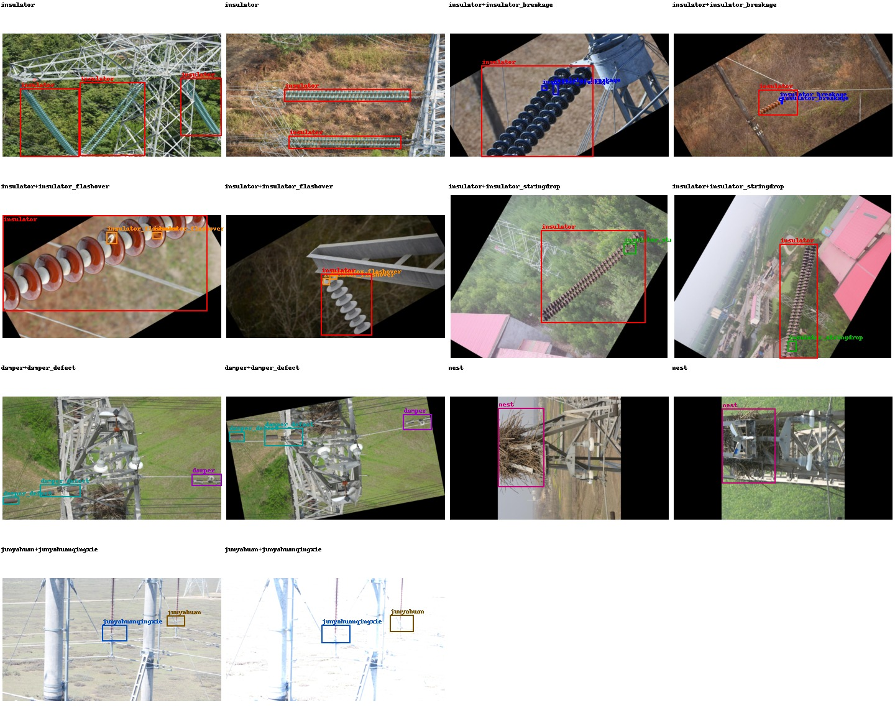

# 数据集问题与对齐方案（7 类绝缘子 vs 9 类电力缺陷）

> 分析日期：2026-11-28
> 分析对象：
> - 7 类绝缘子：`/home/pan/datasets/insulator`
> - 9 类电力缺陷：`/home/pan/datasets/power-defects-9cls`
>
> 分析方式：全量标签几何统计（实例数、框大小、框包含关系）+ 抽样可视化核对。
> 抽样可视化见文末附录。

---

## 0. 结论速览

1. **7 类数据集实际只有 6 类有实例**：`broken_disc` 为 0 实例、0 label 文件；标签空间仍是 7 类，但 mAP 实际按 6 类计算。
2. **两个数据集的 `insulator` 语义不同**：
   - 9 类：`insulator` 是**绝缘子对象父类**（包含正常和带缺陷的绝缘子），缺陷类作为子框；
   - 7 类：`insulator` 更像**普通/未细分绝缘子**，但在 806 张含 `pollution-flashover` 的图里又作为父框出现；其余缺陷类没有父框。
3. **7 类的类别关系是混合语义 + 混合粒度**：类型（`110_two_hight_glass`）、状态（`Glass_Dirty` / `Polyme_Dirty`）、缺陷（`Glass_Loss` / `broken_disc` / `pollution-flashover`）被放在同一个平级标签空间里。`pollution-flashover` 几乎全是局部小框；`Glass_Dirty` / `Glass_Loss` / `Polyme_Dirty` 混有整串大框和局部小框；`110_two_hight_glass` 全是整组框。
4. **为了和 9 类对齐，`insulator` 应定义为“所有绝缘子”**，但不能只改解释：7 类里有 **1,230 张图没有 `insulator` 框**，直接改语义会造成大量漏标。
5. **推荐方案 A**：派生一个 6 类数据集，保留原始数据；按框面积阈值自动复制整串框作为 `insulator` 父框，局部小框所在图像人工补父框。若论文要求严格的“整串父框 + 局部缺陷子框”，需要重新标注局部缺陷（方案 B）。
6. **无论采用哪个方案，`val.py` 的逐类类别名映射都必须修**，否则从第 3 行开始类别名全部错位。

---

## 1. 两个数据集概况

| 项 | 7 类绝缘子 | 9 类电力缺陷 |
| --- | --- | --- |
| 实体路径 | `/home/pan/datasets/insulator` | `/home/pan/datasets/power-defects-9cls` |
| 项目内链接 | `datasets/insulator` | `datasets/power-defects-9cls` |
| 配置文件 | [`configs/datasets/insulator.yaml`](../configs/datasets/insulator.yaml) | [`configs/datasets/power-defects-9cls.yaml`](../configs/datasets/power-defects-9cls.yaml) |
| 图像数 | 2,828 | 7,972 |
| 标签数 | 2,828 | 7,972 |
| 实例数 | 5,669 | 26,345 |
| 磁盘占用 | 185M | 3.4G |
| 图像尺寸 | 全部 640×640 JPG | 原始分辨率，主流 1920×1080 |
| 平均目标数/图 | 2.00 | 3.30 |
| 中位框面积（原图） | 20,700 px² | 5,390 px² |
| split 映射 | `test -> images/val`、`val -> images/test`（反向） | 标准 `train/val/test` |
| 主要用途 | 当前 7 类主实验 | 0718 论文 9 类复现 |

### 1.1 类别清单

**7 类：**

`insulator`、`110_two_hight_glass`、`broken_disc`、`Glass_Dirty`、`Glass_Loss`、`pollution-flashover`、`Polyme_Dirty`

**9 类：**

`insulator`、`insulator_stringdrop`、`insulator_breakage`、`insulator_flashover`、`damper`、`damper_defect`、`nest`、`junyahuan`、`junyahuanqingxie`

---

## 2. 7 类数据集的实际标注语义

### 2.1 实例与图像分布

| 类别 | 实例数 | 出现该类的图像数 |
| --- | ---: | ---: |
| `insulator` | 1,830 | 1,598 |
| `110_two_hight_glass` | 264 | 264 |
| `broken_disc` | **0** | **0** |
| `Glass_Dirty` | 501 | 432 |
| `Glass_Loss` | 171 | 145 |
| `pollution-flashover` | 2,448 | 806 |
| `Polyme_Dirty` | 455 | 390 |

前两类 `pollution-flashover` + `insulator` 占实例的 **75.5%**；`broken_disc` 完全没有实例。

### 2.2 图像级类别组合

| 组合 | 图像数 |
| --- | ---: |
| 只有 `insulator` | 792 |
| `insulator` + `pollution-flashover` | 806 |
| `Glass_Dirty` | 431 |
| `Polyme_Dirty` | 389 |
| `110_two_hight_glass` | 264 |
| `Glass_Loss` | 145 |
| `Glass_Dirty` + `Polyme_Dirty` | 1 |

关键结论：

- 含 `insulator` 的图 1,598 张，其中 **806 张（50.4%）同时有 `pollution-flashover`**；
- **1,230 张图完全没有 `insulator` 框**；
- 除 `pollution-flashover` 外，`insulator` 不与任何其他类别同图出现；
- 模型学到的是“互斥类别”，而不是“绝缘子对象 + 缺陷”的组合。

### 2.3 框包含关系

| 类别 | 中位归一化面积 | 与 `insulator` 框的包含关系 | 语义判断 |
| --- | ---: | --- | --- |
| `insulator` | 0.1322 | 父框/对象框 | 绝大多数是整串框 |
| `110_two_hight_glass` | 0.1309 | 0% 包含 | 整组级，偏型号/类型 |
| `Glass_Dirty` | 0.1550 | 0% 包含 | 整串/局部混合（污秽状态） |
| `Glass_Loss` | 0.1088 | 0% 包含 | 整串/局部混合（玻璃缺失/破损） |
| `pollution-flashover` | **0.0013** | **99.8% 落在 `insulator` 框内** | 局部缺陷区域 |
| `Polyme_Dirty` | 0.2003 | 0% 包含 | 整串/局部混合（污秽状态） |

- `insulator` 框共 1,830 个，其中 **813 个（44.4%）内部包含 `pollution-flashover` 子框**；
- 其余 1,017 个 `insulator` 框没有缺陷子框。

**但同一类别内部也不是单一粒度。** 按归一化框面积统计：

| 类别 | 面积 <0.01 | <0.03 | <0.05 | 解读 |
| --- | ---: | ---: | ---: | --- |
| `insulator` | 0.9% | 3.6% | 7.8% | 绝大多数是整串框，少量局部/局部串 |
| `110_two_hight_glass` | 0% | 0% | 0% | 全部是整组框 |
| `Glass_Dirty` | 8.8% | 21.2% | 28.3% | 多数整串，但约 1/5 是局部污秽小框 |
| `Glass_Loss` | 9.4% | 16.4% | 22.2% | 混有局部玻璃缺失小框 |
| `pollution-flashover` | 96.9% | 99.9% | 100% | 几乎全是局部缺陷框 |
| `Polyme_Dirty` | 5.1% | 10.3% | 13.4% | 以整串为主，少量局部框 |

这意味着：**不能无条件把 `Glass_Dirty` / `Glass_Loss` / `Polyme_Dirty` 的每个框都复制成 `insulator` 父框**。其中约 10%–20% 的框只覆盖局部缺陷，复制后会得到过小、错误的父框。小框示例见 [附录 9.2](assets/dataset_small_boxes_7cls.jpg)。

### 2.4 语义结论

7 类的 `insulator` **不能简单理解为“好的绝缘子”**：

- 792 张 `insulator`-only 图看起来是普通/健康绝缘子；
- 806 张 `insulator + pollution-flashover` 图中，`insulator` 是整串父框，带污闪缺陷；
- 其他缺陷/状态类没有 `insulator` 父框，是独立大框。

因此，7 类的标签体系更接近：

```
类型类：insulator、110_two_hight_glass
状态类：Glass_Dirty、Polyme_Dirty（整串/局部混合）
缺陷类：Glass_Loss（整串/局部混合）、broken_disc（0 实例）、pollution-flashover（局部小框）
```

这些不同层级被放在同一个平级类别空间里，导致语义关系混乱。

---

## 3. 9 类数据集的实际标注语义

### 3.1 实例与图像分布

| 类别 | 实例数 | 出现该类的图像数 |
| --- | ---: | ---: |
| `insulator` | 17,199 | 5,929 |
| `insulator_stringdrop` | 1,064 | 958 |
| `insulator_breakage` | 1,405 | 1,029 |
| `insulator_flashover` | 2,207 | 985 |
| `damper` | 2,464 | 983 |
| `damper_defect` | 1,015 | 863 |
| `nest` | 396 | 386 |
| `junyahuan` | 218 | 119 |
| `junyahuanqingxie` | 377 | 325 |

### 3.2 图像级类别组合

| 组合 | 图像数 |
| --- | ---: |
| 只有 `insulator` | 2,973 |
| `insulator` + 绝缘子缺陷（三类合计，有重叠） | 2,956 |
| `damper` + `damper_defect` | 475 |
| 只有 `damper` | 434 |
| 只有 `damper_defect` | 388 |
| 只有 `nest` | 312 |
| `junyahuan` + `junyahuanqingxie` | 84 |
| 只有 `junyahuanqingxie` | 241 |
| 只有 `junyahuan` | 35 |

含 `insulator` 的图 5,929 张，其中 **2,956 张（49.9%）带至少一种绝缘子缺陷**。

### 3.3 框包含关系

| 类别 | 中位归一化面积 | 与父框的包含关系 | 语义判断 |
| --- | ---: | --- | --- |
| `insulator` | 0.0101 | 父框/对象框 | 整串绝缘子对象 |
| `insulator_stringdrop` | 0.0031 | 99.9% 落在 `insulator` 框内 | 局部缺陷 |
| `insulator_breakage` | 0.0041 | 99.8% 落在 `insulator` 框内 | 局部缺陷 |
| `insulator_flashover` | 0.0017 | 100% 落在 `insulator` 框内 | 局部缺陷 |
| `damper` | 0.0080 | 独立框，0% 落在 `insulator` 框内 | 正常阻尼器/防振锤 |
| `damper_defect` | 0.0122 | 与 `damper` 包含率 0% | 缺陷阻尼器，独立类别 |
| `nest` | 0.0206 | 独立框 | 鸟巢 |
| `junyahuan` | 0.0065 | 独立框 | 正常均压环 |
| `junyahuanqingxie` | 0.0144 | 与 `junyahuan` 包含率 0% | 均压环倾斜，独立类别 |

- `insulator` 框共 17,199 个，其中 **3,091 个（18.0%）内部包含绝缘子缺陷子框**；
- 其余 14,108 个（82.0%）没有缺陷子框。

### 3.4 语义结论

9 类的 `insulator` 是**明确的绝缘子对象父类**：

- 包含正常绝缘子和带缺陷的绝缘子；
- `insulator_stringdrop` / `insulator_breakage` / `insulator_flashover` 是它的局部缺陷子类；
- **不能把 `insulator` 当成“好的绝缘子”**。

但 9 类内部也不完全统一：

- `damper` / `damper_defect` 是**独立类别**，不是父子框；
- `junyahuan` / `junyahuanqingxie` 也是独立类别；
- 只有绝缘子缺陷采用“父对象 + 子缺陷”的方式。

---

## 4. 两个数据集的直接对照

| 项 | 7 类 | 9 类 |
| --- | --- | --- |
| `insulator` 语义 | 普通/未细分绝缘子；部分图兼作污闪父框 | 明确的绝缘子对象父类，正常/缺陷都算 |
| 缺陷是否嵌套 | 只有 `pollution-flashover` 嵌套 | 三个 `insulator_*` 缺陷全部嵌套 |
| 其他类别 | 独立大框，无父框 | `damper` / `junyahuan` 用独立类别 |
| 含 `insulator` 的图中带缺陷比例 | **50.4%**（806/1598） | **49.9%**（2956/5929） |
| `insulator` 框中带缺陷比例 | **44.4%**（813/1830） | **18.0%**（3091/17199） |
| 能否把 `insulator` 当健康类 | **不能** | **不能** |
| 标注粒度 | 类型、状态、缺陷混在一起 | 对象父类 + 缺陷子类为主，damper/junyahuan 例外 |

---

## 5. 核心问题

### P0：`broken_disc` 无实例，7 类实际只评 6 类

- `broken_disc`：0 实例、0 label 文件；
- Ultralytics 的 AP 只对 target 中出现过的类别计算（[`metrics.py:1106`](../ultralytics/utils/metrics.py#L1106)）；
- 因此 7 类模型实际报告的是 **6 类 mAP**；
- class 2 的预测不会进入 mAP，但会在混淆矩阵中显示为 FP；
- 论文中不能写“7 类 mAP”，应写“7 类标签空间，`broken_disc` 无实例，实际评价 6 类”。

### P0：`val.py` 的逐类类别名错位

[`val.py:48-49`](../val.py#L48-L49)：

```python
length = result.box.p.size          # 有 GT 的 6 类
model_names = list(result.names.values())  # 7 类名字
```

实际有 GT 的类别索引是 `[0, 1, 3, 4, 5, 6]`，当前代码按 `[0, 1, 2, 3, 4, 5]` 取名字，导致从第 3 行开始：

| 表格行 | 实际类别 | 当前显示 |
| --- | --- | --- |
| 1 | `insulator` | `insulator` ✅ |
| 2 | `110_two_hight_glass` | `110_two_hight_glass` ✅ |
| 3 | `Glass_Dirty` | `broken_disc` ❌ |
| 4 | `Glass_Loss` | `Glass_Dirty` ❌ |
| 5 | `pollution-flashover` | `Glass_Loss` ❌ |
| 6 | `Polyme_Dirty` | `pollution-flashover` ❌ |
| — | `Polyme_Dirty` | 不显示 ❌ |

正确写法：

```python
ap_idx = result.box.ap_class_index
for i, cls_idx in enumerate(ap_idx):
    model_names[cls_idx],
    result.box.p[i],
    ...
```

### P1：`insulator` 语义不一致，不能直接当健康类

- 7 类：44.4% 的 `insulator` 框带 `pollution-flashover` 子框；
- 9 类：18.0% 的 `insulator` 框带绝缘子缺陷子框；
- 如果论文需要“健康/缺陷”二分类，必须自己派生标签。

### P1：7 类标注粒度混合

- 只有 `pollution-flashover` 是局部缺陷小框（中位面积 0.13%）；
- `Glass_Dirty`、`Polyme_Dirty`、`Glass_Loss`、`110_two_hight_glass` 都是整串级大框（10.9%–20.0%）；
- 模型同时学习“整串对象/状态”和“局部小缺陷”，逐类 AP 不能简单横向比较。

### P1：7 类类别语义混合

- `110_two_hight_glass`：更像型号/类型；
- `Glass_Dirty` / `Polyme_Dirty`：更像污秽状态；
- `Glass_Loss` / `broken_disc` / `pollution-flashover`：才是缺陷；
- 这些不同层级被放在同一个平级标签空间里，论文表述需要明确区分。

---

## 6. 对齐方案

### 方案 A：`insulator` = 所有绝缘子 + 派生 6 类数据集（推荐）

**目标**：让 `insulator` 和 9 类一样表示“所有绝缘子对象”，避免“健康/不健康”歧义。

**做法**：

1. 新建派生数据集，不覆盖原始数据：
   `/home/pan/datasets/insulator-6cls-all/`
2. 删除 `broken_disc`（0 实例），类别重映射：

   | 原类别 | 新类别 |
   | --- | --- |
   | `insulator` (0) | `insulator` (0) |
   | `110_two_hight_glass` (1) | `110_two_hight_glass` (1) |
   | `broken_disc` (2) | 删除 |
   | `Glass_Dirty` (3) | `Glass_Dirty` (2) |
   | `Glass_Loss` (4) | `Glass_Loss` (3) |
   | `pollution-flashover` (5) | `pollution-flashover` (4) |
   | `Polyme_Dirty` (6) | `Polyme_Dirty` (5) |

3. 补 `insulator` 父框（**不能无条件复制**）：
   - 原本有 `insulator` 框的 1,598 张：保持不变；
   - 没有 `insulator` 框的 1,230 张，按框面积分流：
     - **面积 ≥ 0.03** 的整串级框作为父框候选，复制为 `insulator`；
     - **面积 < 0.03** 的框保留为子标签，不直接当父框；
     - 如果一张图只有小框（预计约 **110 张**），需要人工补一个整串父框；
     - `Glass_Dirty` / `Glass_Loss` 中面积在 0.02–0.05 的边界框需要人工复核；
   - `pollution-flashover` 图原本已有父框，不重复添加。
   - 选 0.03 作为初始阈值的原因：自动复制约 1,210 个父框，约 110 张图需人工补父框，约 18 个小框需复核；比“全部复制 1,391 个框”更安全。
4. 预期结果（阈值 0.03 + 人工补父框，按每张人工图补 1 个父框估算）：

   | 项 | 数值 |
   | --- | ---: |
   | 自动复制父框（≥0.03） | 约 1,210 个 |
   | 需人工补父框的图 | 约 110 张 |
   | 新增父框合计 | 约 1,320 个 |
   | 新 `insulator` 框总数 | 约 3,150 个（原 1,830 + 新增约 1,320） |
   | 新实例总数 | 约 6,989（原 5,669 + 新增约 1,320） |
   | `insulator` 占比 | 约 45.1% |
   | `pollution-flashover` 占比 | 约 35.0% |
   | `Glass_Dirty` / `Polyme_Dirty` / `110_two_hight_glass` / `Glass_Loss` | 约 7.2% / 6.5% / 3.8% / 2.4% |
   | 所有图像都有 `insulator` 父框 | 人工补完后是 |

   > 如果直接复制全部 1,391 个框，会得到 3,221 个 `insulator` 框、7,060 个实例（45.6%），但其中约 110 张图的父框会过小、位置错误，**不建议**。

5. 新配置：`configs/datasets/insulator-6cls-all.yaml`，`nc: 6`。
6. 重新训练，**不要和旧 7 类实验的 mAP 混用**。

**局限**：

- 对面积 ≥0.03 的整串框，父框和子框坐标相同；面积 <0.03 的局部框需要人工补父框，不能同框复制；
- `Glass_Dirty` 中约 8.8%、`Glass_Loss` 中约 9.4% 的框小于 0.01，只覆盖局部污秽/缺失区域；直接复制会得到错误父框（示例见 [附录 9.2](assets/dataset_small_boxes_7cls.jpg)）；
- 这不等同于 9 类的“整串父框 + 局部缺陷子框”，即使人工补齐，粒度也更粗；
- 论文中要写清楚：这些是“整串级状态/类型标签”，不是局部缺陷定位；
- `110_two_hight_glass` 是类型，`Glass_Dirty` / `Polyme_Dirty` 是状态，不全是缺陷；
- `insulator` 会变成最大类（约 45.1%），可能拉高整体 mAP，建议同时报告逐类 AP 和不含 `insulator` 的缺陷类 mAP。

### 方案 B：严格层级对齐（需要重新标注）

**目标**：完全复刻 9 类的“父框整串 + 子框局部缺陷”。

**做法**：

- 对 `Glass_Dirty`、`Polyme_Dirty`、`Glass_Loss` 等重新标注局部缺陷区域；
- 父框框整串绝缘子，子框只框缺陷部位；
- `110_two_hight_glass` 作为类型标签，单独定义；
- 工作量最大，但语义最干净。

**适用**：论文核心贡献依赖“对象 + 局部缺陷”的层级结构，且有人力重新标注。

### 方案 C：保持扁平 6 类，不对齐

**做法**：

- 保留原始 7 类标签空间，但只把有实例的 6 类当作评价类别；
- 修 `val.py`，论文注明 `broken_disc` 无实例；
- 不声称和 9 类数据集语义对齐。

**优点**：改动最小，已有实验可继续。
**缺点**：`insulator` 仍是“普通/未细分”语义，不能和 9 类的父类直接对比。

---

## 7. 推荐

| 场景 | 建议 |
| --- | --- |
| 论文主线是 7 类，且需要和 9 类做语义对齐 | **方案 A**：派生 6 类数据集，补父框 |
| 论文核心是“对象 + 局部缺陷”层级 | **方案 B**：重新标注局部缺陷 |
| 只想尽快完成现有实验 | **方案 C**：保持扁平 6 类，修 `val.py`，论文注明口径 |

**当前建议：先做方案 A 的数据准备工作，同时修 `val.py`。** 如果时间不允许重新训练，则退回方案 C，但论文中不要写“`insulator` = 健康绝缘子”，也不要写“7 类 mAP”。

---

## 8. 派生数据集 A 的执行清单

- [ ] 新建 `/home/pan/datasets/insulator-6cls-all/`，不覆盖原始数据
- [ ] 复制 `images/`（或建立软链接，注意可移植性）
- [ ] 生成新 `labels/`：
  - [ ] 删除 `broken_disc`（class 2）
  - [ ] 类别 3–6 重映射为 2–5
  - [ ] 对没有 `insulator` 框的图，先按面积 ≥0.03 自动复制整串级框作为父框
  - [ ] 面积 <0.03 的框保留为子标签，不直接复制
  - [ ] 对只有小框的图（预计约 110 张）人工补整串父框
  - [ ] 抽查 `Glass_Dirty` / `Glass_Loss` 中 0.02–0.05 的边界框
  - [ ] `pollution-flashover` 图保留原父框
- [ ] 校验：
  - [ ] 所有 2,828 张图都有至少一个 `insulator` 框
  - [ ] `insulator` 框总数 ≈ 3,150（自动约 1,210 + 人工约 110，按每图 1 父框估算）
  - [ ] 实例总数 ≈ 6,989
  - [ ] 每个标签文件 5 列，类别 ID 在 0–5
  - [ ] 图像/标签一一对应
- [ ] 新建 `configs/datasets/insulator-6cls-all.yaml`，`nc: 6`
- [ ] 修 `val.py` 的 `ap_class_index` 映射
- [ ] 重训并记录新实验，不与旧 7 类结果混用
- [ ] 论文中说明：
  - [ ] `insulator` = 所有绝缘子对象
  - [ ] `110_two_hight_glass` 是类型，`Glass_Dirty` / `Polyme_Dirty` 是状态
  - [ ] 面积 ≥0.03 的整串框，父/子框同坐标；面积 <0.03 的局部框需要人工补父框

---

## 9. 附录：抽样可视化

红框为 `insulator` 父框/整串框，其他颜色为缺陷/状态/类型框。

### 9.1 7 类数据集



观察要点：

- 第 1 行：`insulator` 红框框整串；`insulator + pollution-flashover` 中青框只框污闪局部；
- 第 2 行：该抽样中 `Glass_Dirty` 橙框、`Glass_Loss` 紫框是整串级大框；
- 第 3 行：`Polyme_Dirty` 品红框、`110_two_hight_glass` 绿框也是整串/整组框。

> 注意：这批抽样恰好挑到整串级框；`Glass_Dirty` / `Glass_Loss` / `Polyme_Dirty` 中还有局部小框，见 9.2。

### 9.2 7 类中的局部小框示例



这些框只覆盖局部污秽/玻璃缺失/聚合物污渍，不是整串绝缘子。它们属于“局部缺陷/状态框”，**不能直接复制成 `insulator` 父框**；对应图像需要人工补整串父框，或按方案 B 重新标注。

### 9.3 9 类数据集



观察要点：

- 第 1 行：`insulator` 红框框整串；`insulator_breakage` 蓝框只框破损局部；
- 第 2 行：`insulator_flashover` 橙框、`insulator_stringdrop` 绿框都是局部小框；
- 第 3 行：`damper` 紫框与 `damper_defect` 青框是**独立框**，不是父子关系；
- 第 4 行：`nest` 品红框是独立目标；
- 第 5 行：`junyahuan` 棕框与 `junyahuanqingxie` 蓝框是**独立框**，不是父子关系。

---

## 10. 参考资料

- 数据集配置：[`configs/datasets/insulator.yaml`](../configs/datasets/insulator.yaml)、[`configs/datasets/power-defects-9cls.yaml`](../configs/datasets/power-defects-9cls.yaml)
- 数据集说明：[`datasets/README.md`](../datasets/README.md)
- 验证脚本：[`val.py`](../val.py)
- 指标实现：[`ultralytics/utils/metrics.py`](../ultralytics/utils/metrics.py)
- 相关分析：[`docs/improve模型分析.md`](improve模型分析.md)、[`docs/消融实验计划.md`](消融实验计划.md)
